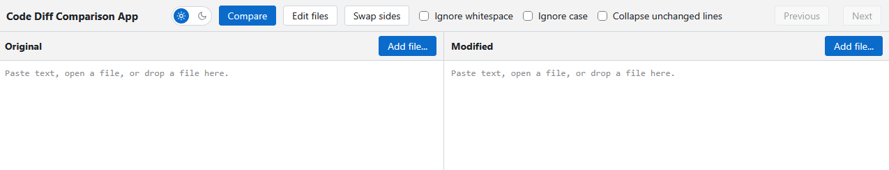
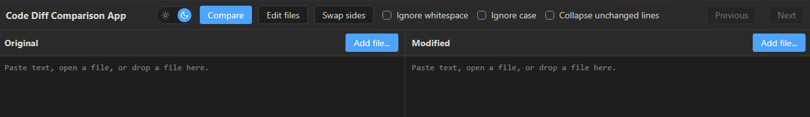
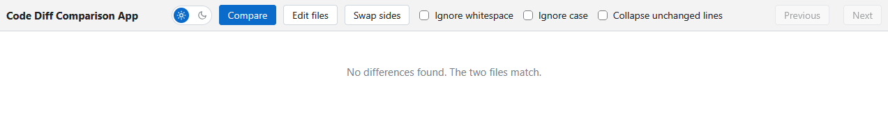
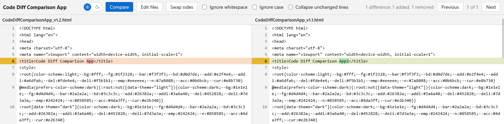

# Code Difference Comparison App

## Overview

This is a local only HTML webpage/app designed to open two different code files side-by-side for a direct comparison. The app can open files that are stored locally on your computer to find and highlight any line-by-line differences using the Myers diff algorithm. The code and app is built with HTML, Javascript, and CSS making it easy to open and use with only a web browser. It requires no configuration, third-party software/libraries, or installation in order to use it. It has been designed and tested primarily for the Windows operating system only. It may work with other operating systems, however this hasn't been tested or verified.

## Features

- File comparison using the Myers diff algorithm
- Code highlighting
- Difference counts
- Previous/Next buttons for code differences
- Local file selector
- Drag and drop file importer
- Show/hide unchanged lines view
- Ignore text case
- Ignore whitespace
- Light/dark mode

## Images

- App open in light mode

  

  

- App open in dark mode

  

  

- Comparing two files with no differences

  

  

- Comparing two files with at least one difference

  

---

**Disclaimer:** This application and project was developed with AI assistance (Claude). The software is provided "as is" without any warranty. DDITTech is not responsible for any errors, damages, or misuse resulting from the use of this application.